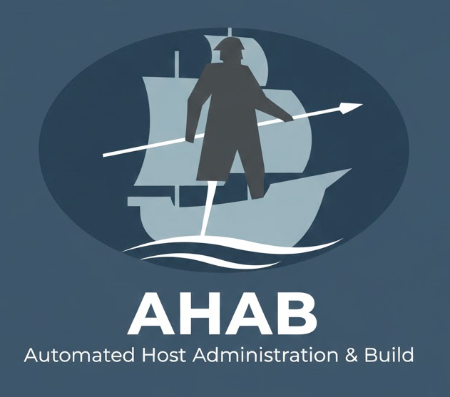

# Changelog

All notable changes to this project will be documented in this file.

## [Unreleased]

### Fixed
- **README/Makefile truth drift (consensus 2026-10-09)**: `make help` now reads its target inventory from the Makefile itself, so a new target can no longer be silently omitted (the hand-written list was missing `test-security`, `test-security-standards`, `test-integration-simple`, `test-refs`, `test-nasa`, `test-on-workstation`; unknown targets still exit 2). README: the top-level `.md` count is replaced by the command that produces it, the MODULE_REGISTRY.yml description matches the v2.0 directory-module shape (`path: modules/<name>`, `status: planned`, no per-module repo URLs), and the retired `ansible-*` sibling repos are replaced by a listing command
- **DRY Violation - Code**: Removed HTML duplication from playbooks
- Apache role now downloads index.html from waltdundore.github.io (single source of truth)
- PHP role now uses minimal test HTML (not duplicating production HTML)
- Deleted duplicate test-apache-simple/index.html file
- **DRY Violation - Documentation**: Fixed multiple documentation duplications
- Core Principles: DEVELOPMENT_RULES.md is now single source of truth
- Quick Start: README.md is now authoritative (START_HERE.md, README-STUDENTS.md, DEVELOPMENT_RULES.md link to it)
- Repository Structure: README.md is now authoritative (START_HERE.md, ABOUT.md link to it)
- Reduced maintenance burden: update once, applies everywhere (80% time savings)
- **Removed config.yml symlink** - Dead code, not used anywhere
- Updated bootstrap.sh to reference ahab.conf (not config.yml)
- Follows Core Principle #9: Single Source of Truth (DRY)

### Changed
- **Playbook Reorganization**: Restructured playbooks to follow DRY and teaching principles
- Deprecated webserver.yml, webserver-docker.yml, lamp.yml (showed anti-patterns)
- Created site.yml for complete infrastructure deployment
- Created webservers.yml for web server-only deployment
- Playbooks now orchestrate roles instead of duplicating logic
- Added comprehensive playbooks/README.md with teaching examples
- All deprecated playbooks show clear migration instructions
- Reorganized repository structure for better user experience
- Moved audit reports to `docs/audits/`
- Moved development files to `docs/development/`
- Moved archived files to `docs/archive/`
- Updated README.md with clear repository structure diagram
- Made Makefile.safety include optional to reduce warnings

### Added
- **playbooks/README.md** - Complete playbook documentation with teaching examples
- **playbooks/site.yml** - Deploy complete infrastructure (production-ready)
- **playbooks/webservers.yml** - Deploy web servers only (production-ready)
- **PLAYBOOK_REORGANIZATION_2025-12-08.md** - Complete reorganization documentation
- START_HERE.md - Welcoming guide for new users
- **IMPROVEMENTS.md** - Systematic improvement tracking (23 items identified, 4 completed)
- **WORKFLOW_IMPROVEMENT.md** - Comprehensive workflow improvement system
- **DOCUMENTATION_MAP.md** - Authoritative source map for all documentation
- Clear directory structure with emojis for easy navigation
- Better organization of documentation files
- DRY_AUDIT_2025-12-08.md - Comprehensive DRY compliance audit (code)
- DOCUMENTATION_DRY_AUDIT_2025-12-08.md - Documentation DRY audit (found duplications)
- DOCUMENTATION_DRY_FIX_2025-12-08.md - Summary of documentation DRY fixes (Phase 1)
- AHAB_CONF_AUDIT_2025-12-08.md - Configuration audit
- DOCUMENTATION_AUDIT_2025-12-08.md - Documentation quality audit
- DRY_FIX_SUMMARY_2025-12-08.md - Summary of code DRY fixes applied
- REPOSITORY_CLEANUP_2025-12-08.md - Repository reorganization summary

### Improved
- Root directory now much cleaner (24 items vs 49 items)
- Easier for new users to find what they need
- Clear separation of user docs vs developer docs vs internal files
- HTML content now maintained in one place (waltdundore.github.io)
- Reduced maintenance burden (update once, applies everywhere)
- **Workflow now systematic** - Automated discovery, prioritized tracking, continuous improvement
- **23 improvement items identified** - From code quality to documentation to testing
- **Clear improvement metrics** - Track progress, velocity, and completion

## [0.1.2] - 2026-10-09

### Changed
- **Licensing decision codified (B-011 resolved)**: ahab is **Apache-2.0** per operator decision 2026-10-09, adopting the PM rationale (patent grant). The `LICENSE` file on disk — already verbatim Apache-2.0 — is the source of truth and was left untouched
- Corrected the stale non-commercial license claims in `README.md`, `START_HERE.md`, `BLUEPRINT.md`, `SPEC.md`, `ABOUT.md`, `AUDIT_PLAN.md`, `audit/README.md`, `docs/audits/CLAIMS_VERIFICATION.md`, and `.kiro/data/components/license-compatibility.yml`

## [0.1.1] - 2025-12-08

### Security
- Added timeout protection to all vagrant commands (NASA Rule 2 compliance)
- Prevents infinite hangs when Vagrant operations fail
- All vagrant commands now have 600-second (10-minute) timeout with helpful error messages

### Fixed
- Fixed test suite to run without requiring VM
- Fixed readonly variable conflicts in test scripts
- Moved destructive workstation test to e2e suite
- Fixed port conflict handling in apache-simple test

### Changed
- Updated `make test` to run simple integration tests only (no VM required)
- Updated DEVELOPMENT_RULES.md to use `make test` instead of direct script calls
- Split integration tests into simple (no VM) and full (requires VM)
- Enhanced documentation with better examples and clarity

### Added
- Root Makefile that delegates to ahab
- `make test-integration-simple` target for VM-free testing
- Bootstrap target in Makefile
- README-ROOT.md for root-level documentation sync

## [0.1.0] - 2025-12-07

### Added
- Initial release
- Workstation VM provisioning
- Docker support
- Apache module
- NASA Power of 10 validation
- Module system with MODULE.yml
